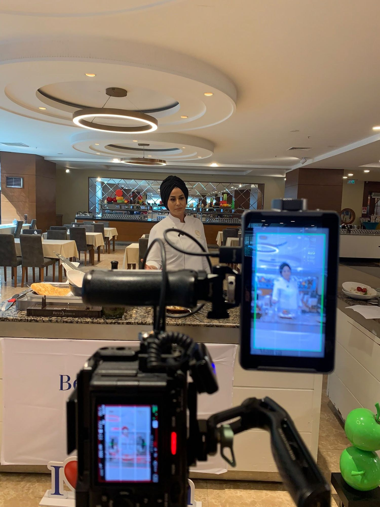

İyi bir otel tanıtım filmi senaryosu, misafirin otelde geçireceği bir günü sırayla anlatır: varış, oda, havuz ya da plaj, yemek, akşam ve gece. Senaryo yazmadan önce iki soruya cevap verilir: Bu otel kim için, misafir orada ne hissedecek? Aile oteli ile yetişkinlere yönelik butik bir otelin filmi aynı plan listesiyle çekilmez. Senaryo bu cevaplara göre kurulur, çekim listesi de senaryodan çıkar.

## Önce ruh hâli

Senaryonun ilk satırı otelin kime hitap ettiği. Birkaç örnek:

| Otel tipi | Öne çıkan ruh hâli | Filmde öne çıkanlar |
|---|---|---|
| Aile oteli | Rahatlık, çocuklarla tatil | Havuz, aktivite alanları, geniş odalar |
| Butik otel | Sakinlik, kişisel ilgi | Detaylar, oda, kahvaltı, manzara |
| Denize sıfır resort | Deniz, güneş, büyüklük | Havadan plaj ve havuz, gün batımı |
| Şehir oteli | Konum, kolaylık | Çevredeki yerler, ulaşım, lobi |

Ruh hâli belirlenince müzik, renk ve kurgu temposu da belirlenmiş olur.

## Sahne sırası: misafirin günü

Otel filminin en anlaşılır yapısı, bir misafirin gününü sırayla göstermek. Şablon olarak:

1. Açılış: havadan otel, deniz ve çevre
2. Varış: giriş, lobi, karşılama
3. Oda: perdenin açılması, manzara, yatak ve banyo detayları
4. Gündüz: havuz, plaj, aktiviteler
5. Yemek: kahvaltı, restoran, bar
6. Akşam: gün batımında teras, ışıkları yanan otel
7. Kapanış: havadan gece görüntüsü ve logo

Bu sıra çekim gününün sırasıyla aynı olmak zorunda değil. Çekim ışığa göre, kurgu senaryoya göre sıralanır. Hangi planın hangi saatte çekileceğini [otel ve yat için drone tanıtım videosu](/blog/otel-yat-drone-tanitim-videosu/) yazısında anlattık.

## Dış ses mi müzik mi röportaj mı?

Otel filminde üç yol var:

- Yalnız müzik ve görüntü: Dil bilmeyen misafir de anlar. Yabancı misafiri çok olan otellerde en sorunsuz seçenek.
- Dış ses: Metin stüdyoda okunur. Otelin sunduğu hizmetleri tek tek anlatmak gerekiyorsa işe yarar ama her dil için ayrı seslendirme gerekir.
- Röportaj: Otel sahibi ya da şef kameraya konuşur. Aile işletmesi ve butik otellerde samimiyet katar. Ses kaydı ve sessiz bir ortam gerekir.

Senaryo türlerini kurumsal filmler için [tanıtım filmi çekimi](/blog/tanitim-filmi-cekimi/) yazısında daha ayrıntılı anlattık.

## Gerçekte olanı gösterin

Filmde görünen her şey misafirin gerçekten bulacağı şey olmalı. Konaklamaya dahil olmayan bir hizmeti filmde öne çıkarmak, sonra hayal kırıklığı ve kötü yorum olarak geri döner. Odanın görünümü, havuzun büyüklüğü ve plaja uzaklık filmde nasılsa gerçekte de öyle olmalı.

## Misafirler ve personel

Senaryoda misafir görünecekse kimlerin olacağı önceden kararlaştırılmalı. Yüzü net görünen her misafirden izin almak gerekir. Bu yüzden misafir sahneleri çoğu zaman otelin tanıdık misafirleriyle ya da personelle çekilir. Kalabalık alanlar misafirin az olduğu saatte ya da yüzlerin seçilmediği açıdan alınır.

## Tek çekimden birden fazla kesim

Senaryo yazılırken filmin nerede kullanılacağı da yazılmalı. Aynı çekimden:

- Web sitesi için yatay 16:9 uzun versiyon
- Booking ve rezervasyon siteleri için yatay kısa kesim
- Instagram Reels ve TikTok için dikey 9:16 kesimler

Bütün görüntüyü 4K çekiyoruz, havadan planları 4K, 50 ya da 60 fps. Dikey kesimler için önemli sahneleri çekim günü dikey kadraja göre de düşünüyoruz. Otel için fotoğraf çekimi de planlanıyorsa [otel fotoğraf çekimi](/blog/otel-fotograf-cekimi/) yazısındaki hazırlık listesi iki çekim için ortak.

## Sık sorulanlar

### Otel tanıtım filmi senaryosunu kim yazar?

Kurumsal tanıtım filminde senaryo, çekim ve post-prodüksiyon hizmetimize dahil. Otelden beklediğimiz, hedef misafiri ve filmin nerede kullanılacağını netleştirmek.

### Otel tanıtım filmi kaç dakika olmalı?

Kullanılacak yere göre değişir. Web sitesi için daha uzun bir versiyon, Booking ve sosyal medya için kısa kesimler hazırlanır. Süreleri çekimden önce birlikte belirliyoruz.

### Otel filminde dış ses mi müzik mi kullanılmalı?

Yabancı misafiri çok olan otellerde sözsüz, müzikli kurgu en sorunsuz yol. Hizmetleri tek tek anlatmak gerekiyorsa dış ses eklenebilir ama her dil için ayrı seslendirme gerekir.

### Otel tanıtım filminde drone şart mı?

Konumu, plajı ya da büyüklüğü öne çıkan otellerde havadan plan ilk saniyede bunları anlatır. Uçuştan önce otelin ve bölgenin izin durumunu kontrol ediyoruz. Ayrıntılar [drone çekimi](/drone/) sayfasında.

### Antalya'daki oteller için de çekim yapıyor musunuz?

Evet. Alanya merkezliyiz, Alanya ve Antalya'da çalışıyoruz. Mekân tanıtım videosu hizmetinin ayrıntıları [hizmetler](/hizmetler/#kurumsal) sayfasında.
