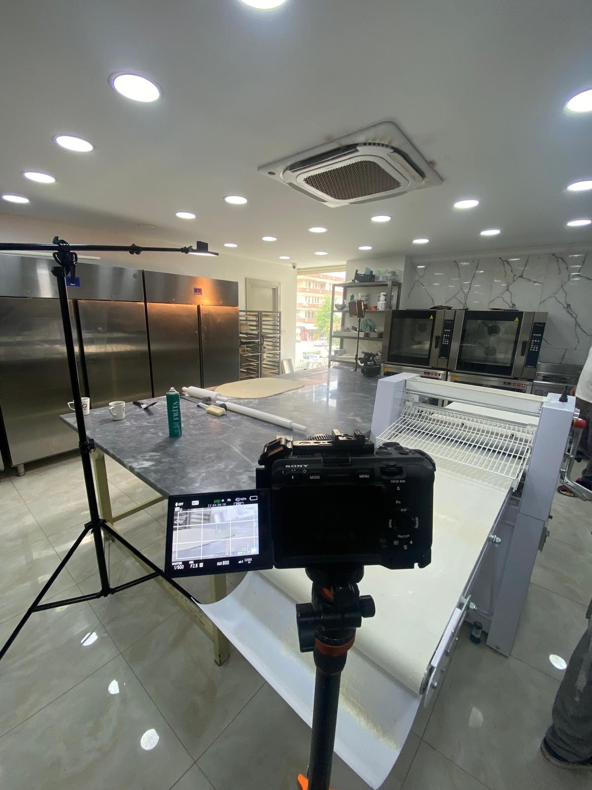
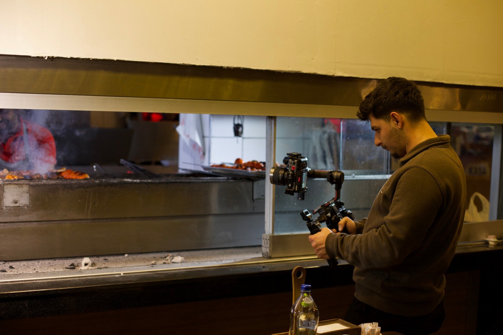

Sosyal medya yönetimi, bir işletmenin Instagram ve TikTok hesabı için her ay neyin paylaşılacağını planlamak, bu içerikleri üretmek ve takvime oturtmaktır. Alanya ve Antalya'da otel, restoran ve mağaza gibi işletmeler için en çok zaman alan kısım içerik üretimidir: çekim, kurgu ve Reels. Bizim aylık içerik paketimiz konsepti, çekimi, kurguyu ve takvimi kapsıyor.

## Aylık içerik üretimi neleri kapsar?

Ajanstan ajansa kapsam değişir. Teklifi karşılaştırırken kalemleri tek tek sormak gerekir.

| Kalem | Ne demek | Bizde |
|---|---|---|
| Konsept | Ayın konuları, kampanyalar, sezon | Dahil |
| Çekim | Fotoğraf ve video, gerekirse drone | Dahil |
| Kurgu | Reels, TikTok ve hikâye kesimleri | Dahil |
| Takvim | Hangi içeriğin hangi gün paylaşılacağı | Dahil |
| Paylaşım, yorum ve mesaj cevapları | Hesabın günlük işleri | Görüşmede belirlenir |
| Reklam | Ücretli tanıtım ayarları | Görüşmede belirlenir |

Hesabın günlük işlerini kimin yapacağı baştan yazılı olmalı. Yorumlara ve mesajlara işletmenin kendisi cevap veriyorsa içerik üreten ekiple aynı dili konuşması gerekir.

## Bir ay nasıl ilerler?

1. Ay başında kampanyalar, yeni ürünler, etkinlikler ve sezon konuşulur.
2. Her paylaşım için gereken planlar bir çekim listesine yazılır.
3. Ayın içeriklerinin büyük kısmı bir ya da birkaç çekim gününde toplanır.
4. Kurguda Reels ve TikTok için dikey 9:16, gerekirse web için yatay 16:9 kesimler hazırlanır.
5. İşletme içerikleri görür, onaylananlar takvime yerleşir.

Çekimi tek günde toplamak işletmenin düzenini daha az bozar. Mekân bir kez hazırlanır, personel bir kez bilgilendirilir.

## İşletmeden beklenenler

- Ürün, menü ya da hizmetle ilgili doğru bilgi
- Kampanya ve etkinlik tarihleri, mümkünse ay başında
- Çekim günü mekânın hazır olması
- Görüntüye girecek çalışanların ve misafirlerin izni
- Marka renkleri, logo ve varsa yazı karakteri

İzin konusunu hafife almayın. Misafirin yüzünün net göründüğü bir video, izni alınmadan paylaşılmamalı.

## Alanya'da sezon ve dil

Alanya'da yaz sezonu yoğun geçiyor. Otel, restoran ve tur gibi işletmelerde sezon öncesi içerik hazırlığı, sezon içindekinden daha rahat yürür. Mekân boşken çekilen görüntüler sezon boyunca kullanılabilir.

Yabancı misafire hitap eden işletmelerde videoyu sözsüz ve müzikli kurgulamak dil sorununu ortadan kaldırır. Ekran yazısı gerekiyorsa kısa tutup birkaç dilde hazırlamak mümkün.

## Ne paylaşılır?

Sektöre göre değişir. Otel için havadan bir açılış planı, restoran için mutfaktan bir tabak, mağaza için yeni gelen ürün iyi başlangıçlar. Sektör sektör fikirleri [işletmeler için Instagram Reels fikirleri](/blog/isletme-reels-fikirleri/) yazısında topladık. Reels'i kendiniz çekecekseniz [Instagram Reels nasıl çekilir](/blog/instagram-reels-ipuclari/) yazısındaki notlar işinize yarar.

Kısa bir hazırlık anı bile tek başına içerik olur. Bir kebap restoranı için çektiğimiz tanıtımda turkuaz fonun önünde dökülen soğanı ağır çekimle kullandık; mangal planlarıyla birlikte dikey kurguya girdi. Diğer örnekler [galeride](/galeri/).

<video data-src="/media/sogan-onizleme.mp4" width="464" height="824" muted loop playsinline preload="metadata" aria-label="Közde dumanlar içinde tavuk şiş, turkuaz fonun önünde eldivenli elden dökülen doğranmış soğan ve ızgarada et, ağır çekim" style="width:min(100%,18rem);height:auto;display:block"></video>

Bir açılış ya da lansman varsa o günü ayrıca çekmek ayın en güçlü içeriğini verir. Kuyumcu açılışında nasıl çalıştığımızı [açılış töreni çekimi](/blog/acilis-toreni-cekimi/) yazısında anlattık.

## Sık sorulanlar

### Sosyal medya yönetimi neleri kapsar?

Genellikle içerik planı, çekim, kurgu, takvim ve paylaşım. Hesabın günlük işleri ve reklam ise her teklifte farklıdır. Bizim aylık paketimizde konsept, çekim, kurgu ve takvim yer alıyor.

### Hangi platformlar için içerik üretiyorsunuz?

Instagram ve TikTok başta olmak üzere kısa dikey video kullanan platformlar için. Web sitesi ve tanıtım için yatay kesim de hazırlanabiliyor.

### Takipçi ya da izlenme garantisi veriyor musunuz?

Hayır. İzlenme ve takipçi sayısı platformun algoritmasına, paylaşım düzenine ve sektöre bağlı. Biz içeriğin kalitesinden ve düzenli üretilmesinden sorumluyuz.

### Sosyal medya yönetimi fiyatı neye göre değişir?

Aylık içerik sayısı, çekim günü sayısı, drone ihtiyacı ve hesabın günlük işlerinin pakete dahil olup olmadığı belirler. Kapsamı görüşüp teklif hazırlıyoruz.

### Antalya'daki işletmelerle de çalışıyor musunuz?

Evet. Alanya merkezliyiz, Alanya ve Antalya'da çalışıyoruz. Hizmetin ayrıntıları [hizmetler](/hizmetler/#kurumsal) sayfasında, tarih için [iletişim](/iletisim/) sayfasından yazabilirsiniz.
